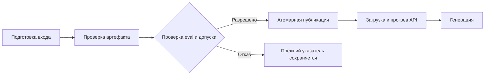

# ДЗ 8–10 · Надёжный выпуск модели и работающий API

**Обновлено: 3 ноября 2026 года.** Результаты ниже относятся к последнему сохранённому прогону в `D:\mlops26-hw8-9-10-solution`.

| Что проверено | Результат |
|---|---|
| Быстрые проверки | **48 тестов прошли**: 24 этой работы и 24 из ДЗ 6–7 |
| Доказательство исправлений | **6 интеграционных тестов** падают на исходной версии и проходят после исправлений |
| Процесс выпуска | Проверены кеш, восстановление, отказ и отсутствие повторных публикаций |
| Настоящая модель | Baseline загружена через Transformers; smoke-запрос получил **HTTP 200** |
| Неверный запрос | **HTTP 422**, число вызовов модели осталось **1 → 1** |
| Нагрузочный опыт | **16 из 16 запросов успешны**, ошибок и тайм-аутов нет |

> **Решение по качеству:** кандидат из ДЗ 6–7 отклонён — «Не все behavioral-кейсы пройдены». Пороги не ослаблялись. API обслуживает ранее закреплённую **baseline**, а не отклонённый адаптер.

[Семь дефектов](defects.csv) · [Инструкция запуска](README.md) · [Сохранённые доказательства](evidence)

## 1. Что реализовано

Исправлен стартовый прототип и построена цепочка выпуска: подготовка входа, проверка артефакта, проверка оценки и решения о допуске, безопасная публикация, загрузка модели в API.

| Компонент | Реализация |
|---|---|
| Контракты и атомарная запись | [`release.py`](release.py) |
| Подготовка, кеш и журнал выпусков | [`pipeline.py`](pipeline.py) |
| Оркестрация четырёх задач | [`flow.py`](flow.py), Prefect |
| HTTP-сервис и загрузчики | [`service.py`](service.py), [`backends.py`](backends.py), FastAPI |
| Связь с оценкой ДЗ 6–7 | [`hw67_bridge.py`](hw67_bridge.py) |
| Единый быстрый запуск | [`check.py`](check.py) |
| Реальный smoke и замер | [`run_real.py`](run_real.py), [`benchmark.py`](benchmark.py) |

Исходная версия сохранена коммитом `6a91b19`. Стартовые тесты не ослаблялись; их побайтовая идентичность подтверждена в [отпечатках тестов](evidence/tests-fingerprint.json).

## 2. Семь независимых причин ошибок

Полные команды воспроизведения, причины и имена тестов приведены в [`defects.csv`](defects.csv).

| ID | Ошибка исходного прототипа | Исправление и проверяемое свойство |
|---|---|---|
| D01 | Кеш зависел от пути, но не от содержимого входа и настроек | Ключ учитывает байты, конфигурацию и фактический код подготовки; изменение входа сбрасывает кеш |
| D02 | Неполный или чужой отчёт мог разрешить выпуск | Проверяются схема, настоящий boolean PASS, метрики, версии и хеши |
| D03 | Прямая запись могла повредить принятый указатель | Временный файл рядом с целью, `flush/fsync`, `os.replace`; при ошибке прежние байты сохраняются |
| D04 | Повтор выпуска добавлял дубликаты в журнал | Устойчивый release ID, отдельный журнал попыток и восстановление по write-ahead intent |
| D05 | Сервис сообщал о готовности до прогрева | Ready становится успешным только после проверки файлов, загрузки и настоящего warmup |
| D06 | Метаданные сообщали новую версию при старой модели в памяти | ID и runtime берутся из загруженного backend; смена версии подтверждается после перезапуска |
| D07 | Неверный запрос запускал вычисление | Типы, длины и лимиты проверяются до `backend.generate`; счётчик вызовов не меняется |

## 3. Prefect: выпуск, кеш и восстановление



Задачи передают небольшие описания: пути, URI, run ID и хеши. Веса и тензоры не передаются как результаты задач. Готовый training run из ДЗ 6–7 переиспользуется; чтение его результата не является новым обучением.

Подготовка реально декодирует, проверяет и нормализует вход, затем сохраняет результат на диск. Ключ включает содержимое входа, tokenizer revision/hash, шаблон, `max_length`, версию и хеш кода обработки. Prefect дополнительно учитывает рабочий каталог, потому что результат содержит локальный URI.

| Шаг | Опыт | Код завершения | Подтверждение |
|---|---|---:|---|
| 00 | Создание отдельного STUB-стенда | 0 | Исходная принятая версия A |
| 01 | Управляемый сбой после подготовки | **1, ожидаемый** | Подготовка выполнена и сохранена |
| 02 | Повтор в новом процессе | 0 | Состояние подготовки `Cached` |
| 03 | Изменение байтов входа по прежнему пути | 0 | Новая подготовка, состояние `Completed` |
| 04 | Повтор успешного выпуска | 0 | Число событий выпуска не увеличивается |
| 05 | Сбой между сменой указателя и записью журнала | **1, ожидаемый** | Сохранено намерение публикации |
| 06 | Восстановление после этого сбоя | 0 | `RECOVERED_PUBLICATION`, без двойного события |
| 07 | Отклонённый отчёт | **1, ожидаемый** | Прежний `accepted.json` не изменён |

Доказательства: [команды и exit codes](evidence/experiments/commands.json), [журналы опытов](evidence/experiments), [попытки](evidence/experiments/attempts.jsonl), [события выпусков](evidence/experiments/publications.jsonl).

Публикация рассчитана на **одного писателя**. Release ID связан с manifest, runtime и решением допуска. Повтор одной версии не создаёт второе событие; попытки учитываются отдельно. В текущем офлайн-потоке автоматические повторы отключены. Отказ по качеству и несовместимость не исправляются retry; для будущего сетевого получения артефактов допустим ограниченный retry временных сетевых ошибок.

## 4. Связь с ДЗ 6–7 и решение о качестве

| Поле | Значение |
|---|---|
| Базовая модель | `Qwen/Qwen3-0.6B` |
| Точная revision | `c1899de289a04d12100db370d81485cdf75e47ca` |
| Candidate training run | `57fbd1f0f16b4f088378a227c4059e5a` |
| Evaluation run | `8f382885e3f548d6907b19e6af2716e2` |
| Gate кандидата | **FAIL** — Не все behavioral-кейсы пройдены |
| Выбранное действие | Сохранить закреплённую baseline |

[`hw67_bridge.py`](hw67_bridge.py) проверяет исходные отчёты и сырые ответы, IDs, протокол, golden set и отсутствие пересечений с train; заново рассчитывает `score` и `quality_gate`. В [`evidence/hw67`](evidence/hw67) сохранены исходные отчёты, данные, код оценки и тесты.

> `passed: true` в release-report baseline означает разрешение **сохранить прежнюю baseline после вычисленного отказа кандидату**. Поле `candidate_gate.passed` остаётся `false`. Это не PASS кандидату и не утверждение, что baseline прошла все behavioral-кейсы.

Перед выпуском и загрузкой пересчитываются хеши реальных файлов артефакта. Проверяется совпадение версий и runtime; неполный отчёт, чужая модель, NaN/Inf, устаревший хеш или изменённые файлы блокируют выпуск.

<details>
<summary>Manifest и идентификаторы воспроизводимости</summary>

```text
model_id: baseline-Qwen3-0.6B-c1899de289a04d12100db370d81485cdf75e47ca
runtime_sha256: 7b2e932d0dfc55a09ba460e6512db62048fce9d32818dde9f174cdb7de882006
protocol_sha256: f9ad7f9cacfdad2c9b7a3b4f9799b3f83ef5672af3672ce2a179fceaf7e776bc
golden_sha256: 563ef4db75701635b64666a487e486a12fb4e82c353db565b5adc31c6a8f3ccd
```

[Manifest](evidence/release/manifest.json) · [Release-report](evidence/release/release-report.json) · [Отказ кандидату](evidence/release/rejected-candidate.json) · [Журнал реального выпуска](evidence/release/publish.log)

Runtime восстановлен по точной revision, коду оценки и сохранённым параметрам CPU/float32. Старый eval не содержал готового `runtime_sha256`; новая полная генерация eval не заявляется. Связь исходных файлов защищена SHA-256 в `source_files`.

</details>

При отрицательном опыте SHA-256 указателя до и после совпал:

```text
до:    d63e76e1238c39c88b64a9b7bce17f2e0c3ae8e2193b7b20f9a89497e45e5392
после: d63e76e1238c39c88b64a9b7bce17f2e0c3ae8e2193b7b20f9a89497e45e5392
```

Источник: [pointer-rejection.json](evidence/experiments/pointer-rejection.json). Ошибка диска проверяется через mock, без заполнения или повреждения настоящего диска.

## 5. Тесты и доказательства «до → после»

| Набор | Число тестов | Последний результат |
|---|---:|---|
| Приложенные контракты выпуска | 13 | OK |
| Собственные интеграционные проверки | 6 | OK |
| Дополнительные проверки восстановления и артефактов | 5 | OK |
| Сохранённые тесты ДЗ 6–7 | 24 | OK |
| **Всего** | **48** | **Все прошли** |

Из шести интеграционных тестов три обращаются к настоящему локальному HTTP-серверу; остальные проверяют CLI через subprocess. Файловая система и границы процессов реальные, модель заменена STUB. Каждый тест получает отдельный workspace.

```text
original exit code: 1
fixed exit code: 0
All six regressions fail meaningfully before and pass after.
```

На исходном коммите тесты падают по проверяемым свойствам, без ошибок импорта или несуществующих команд. На исправленной версии те же проверки проходят. Рабочий код при этом не портится: исходная версия извлекается в изолированную копию.

[Быстрый прогон](evidence/checks/green.log) · [Тесты ДЗ 6–7](evidence/checks/hw67-preserved.log) · [Красный журнал](evidence/regressions/original.log) · [Зелёный журнал](evidence/regressions/fixed.log) · [Сводка регрессий](evidence/regressions/summary.json)

CI выполнен локально. Удалённый GitHub Actions и защита merge обязательными проверками не заявляются.

## 6. Настоящий API: результат smoke-проверки

Сервис предоставляет `GET /health`, `GET /ready` и `POST /generate`. Health подтверждает жизнь процесса; ready — проверенные файлы, загрузку выбранной модели и успешный прогрев. В журнале запуска зафиксированы ответы **503 до готовности и 200 после загрузки и прогрева**.

| Проверка | Последний результат |
|---|---|
| Backend | **Transformers**, настоящая baseline |
| Корректный запрос | **HTTP 200** |
| Ответ модели | `{"answer":"REFUSE"}` |
| Выходные токены | **7** |
| Длительность генерации | **2.160 с** |
| Время внутри сервиса после проверки запроса | **2.160 с** |
| Неверный лимит генерации | **HTTP 422** |
| Вызовы backend до / после неверного запроса | **1 / 1** |
| Request ID успешного smoke | `a455f823-3cd6-4508-988c-d5e9b6cfa606` |

**HTTP 200 подтверждает успешное обслуживание, а не правильность решения задачи.** Ответ `REFUSE` сохранён без подмены; низкое качество baseline не скрывается. Счётчик `1 → 1` показывает, что неверный запрос не запускал генерацию; первый вызов относится к прогреву.

Лимиты: тело запроса до 65 536 байт, prompt до 8 000 символов и 2 048 токенов с шаблоном. Для реальной модели `max_new_tokens=16` фиксирован протоколом оценки: greedy, `do_sample=false`, `enable_thinking=false`, `seed=42`. Одновременно вычисляется одна генерация, остальные запросы ожидают lock.

Доказательства: [полный smoke-результат](evidence/real-api/smoke.json), [готовность при запуске](evidence/real-api/startup.json), [журнал сервера](evidence/real-api/server.log).

## 7. Производительность: последний замер 8 + 8

После прогрева выполнены **одинаковые восемь запросов** при параллельности 1 и затем 2. Для всех запросов сохранён бюджет `max_new_tokens=16`; фактическое число выходных токенов записано в журнал. Ни ошибки, ни тайм-ауты из результатов не удаляются.

| Параллельность | Запросов | Успех / ошибка | Время пакета, с | Успешных запросов/с | Средняя задержка, с | Максимальная задержка, с | Выходных токенов всего |
|---:|---:|---:|---:|---:|---:|---:|---:|
| 1 | 8 | 8 / 0 | 12.463 | 0.642 | 1.558 | 2.117 | 55 |
| 2 | 8 | 8 / 0 | 12.453 | 0.642 | 2.954 | 3.706 | 55 |

**Все 16 запросов успешны.** Ошибок и тайм-аутов в этом прогоне нет; средняя и максимальная задержки ошибок в исходной сводке равны `null`, поскольку таких наблюдений нет.

Пропускная способность почти не изменилась — около **0,642 запроса/с**. Средняя клиентская задержка при двух клиентах выросла примерно в **1.9 раза**. Это согласуется с последовательным backend: дополнительные запросы ожидают освобождения вычисления.

`client_seconds` включает транспорт, проверку запроса, очередь и получение полного ответа. `generation_seconds` отражает выполнение backend под lock; ожидание записывается отдельно в `queue_seconds`.

[Все 16 попыток](evidence/benchmark/requests.jsonl) · [Машиночитаемая сводка](evidence/benchmark/summary.json)

> Это небольшой локальный замер на CPU: восемь наблюдений на режим и один прогон. Он не доказывает устойчивый p95 или производительность vLLM/SGLang. TTFT и ITL не измерялись: API возвращает единый JSON, без streaming.

Prefill обрабатывает входной prompt; decode последовательно создаёт выходные токены. KV-cache хранит attention keys/values и расходует больше памяти при росте длины и числа активных последовательностей.

## 8. Смена модели и управляемый откат

На двух лёгких **STUB-версиях** выполнен опыт A → B → A:

| Этап | Версия в указателе | Версия, реально загруженная в API |
|---|---|---|
| Сервис запущен на A | A | A |
| Опубликована B, перезапуска ещё нет | B | A |
| Сервис перезапущен | B | B |
| Указатель возвращён на A | A | B |
| Сервис снова перезапущен | A | A |

Ответ и метаданные соответствовали backend в памяти. Источник: [http-A-B-A.json](evidence/experiments/http-A-B-A.json). Этот опыт проверяет управление версиями; он не выдаётся за полноценный eval двух настоящих моделей.

Для отката реальной версии нужно взять ранее принятые согласованные manifest/report, перепроверить файлы и решение, опубликовать указатель через тот же flow, перезапустить API, проверить ready, `model_id`, `runtime_sha256` и выполнить smoke. Второй реально принятой версии в этой работе нет.

## 9. Как воспроизвести

Из корня проекта в PowerShell:

```powershell
.\.venv\Scripts\python.exe check.py
.\.venv\Scripts\python.exe prove_regressions.py
.\.venv\Scripts\python.exe experiments.py
.\.venv\Scripts\python.exe publish_real.py
.\.venv\Scripts\python.exe run_real.py --python "D:\mlops26-hw6-7\hw67-solution\.venv\Scripts\python.exe" --count 8
```

Последняя команда использует окружение ДЗ 6–7 для модельных библиотек. Если они установлены в собственное `.venv` этой работы, параметр `--python` можно опустить. Инструкция восстановления на другом компьютере — в [README](README.md).

| Изменение | Требуемое действие |
|---|---|
| Код | Быстрые тесты; изменение промпта, декодирования или загрузки требует повторной оценки |
| Данные | Проверка схемы и инвалидация кеша; изменение eval-данных требует новой оценки |
| Адаптер | Проверка загрузки и файлов, полная оценка, gate, новый связанный manifest/report, затем выпуск |

Во время повторения опытов нужно отличать ожидаемые коды `1` в отрицательных сценариях от неожиданного падения всего скрипта. Успешный `experiments.py` завершается строкой `All Prefect and HTTP experiments verified.`

## 10. Среда и границы результата

| Компонент | Версия / конфигурация |
|---|---|
| ОС и Python | Windows x64, Python 3.12.14 |
| Оркестрация | Prefect 3.9.1 |
| Быстрое окружение / STUB API | FastAPI 0.150.0, Uvicorn 0.54.0 |
| Реальный модельный API | FastAPI 0.142.2, Uvicorn 0.54.0 |
| Модельные библиотеки | Torch 2.14.0, Transformers 5.17.0, PEFT 0.21.0 |
| Вычисления | CPU, float32 |

- В этом прогоне не выполнялись новое обучение, sweep и повторный полный eval. Использованы сохранённые результаты ДЗ 6–7 с проверкой их согласованности.
- Веса отклонённого адаптера из MLflow не загружались; его происхождение, оценка и отказ сохранены. Реально загружена baseline.
- В Git не включены веса, `.venv`, кеши и секреты. Точную публичную baseline можно восстановить через `prepare_model.py` по закреплённой revision и SHA-256 файлов.
- Docker, Kubernetes, streaming и удалённый CI не использовались. Это не является результатом данных локальных проверок.
- Скрипты учитывают системный прокси при обращении к localhost и различие владельцев Git-репозитория между средами Windows.

## 11. Материалы сдачи

| Материал | Где находится |
|---|---|
| Исходный и исправленный проект | История коммитов репозитория |
| Семь причин и исправления | [defects.csv](defects.csv) |
| Быстрые тесты | [tests](tests), [evidence/checks](evidence/checks) |
| Красные и зелёные доказательства | [evidence/regressions](evidence/regressions) |
| Сбои, кеш, отказ и откат | [evidence/experiments](evidence/experiments) |
| Manifest и решение выпуска | [evidence/release](evidence/release) |
| Реальный ответ API | [evidence/real-api](evidence/real-api) |
| Все измерения | [evidence/benchmark](evidence/benchmark) |

Видео 5–8 минут записывается отдельно. **Ссылка на видео будет добавлена после записи.**
